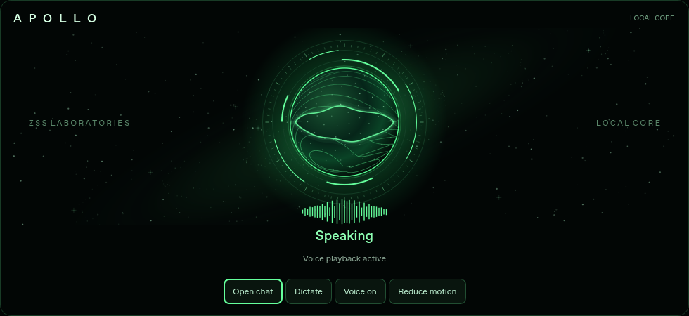

# Apollo Home activity core

Home now includes a luminous green energy sphere, rotating instrument rings and
a cached starfield/galaxy on an almost-black background. Existing pinned apps,
layout editing and shortcuts remain below it.

The sphere and glow breathe on a steady 5.6-second cycle. Instrument rings turn
at 5–12 degrees per second depending on activity, independently of the plasma.
Two opposing energy waves open and close like abstract lips during speech;
measured silent audio closes them instead of inventing syllables. A short
attack/release smooths volume changes. This is amplitude-driven motion, not
phoneme-accurate lip synchronization.

The display observes real application state:

| State | Trigger | Visual response |
| --- | --- | --- |
| Ready | No observed foreground or runtime action | 5.6-second green breathing and slow orbit |
| Listening | Existing dictation task active | Expanding concentric rings |
| Thinking | Chat generating a response | Faster counter-rotating rings and plasma |
| Researching | Active search/fetch/research tool | Research label, tool name and active orbit |
| Working | Other active tool or current-process runtime action | Working label and capability name |
| Preparing voice | Speech request queued or local generation active | Moving core while audio is prepared |
| Speaking | Windows speech or Voice Imprint playback process active | Opposing speech waves open/close; signal bars follow volume |
| Needs attention | Recent chat/dictation/voice failure, when no work is active | Plain-language failure for 12 seconds |

Voice Imprint PCM16 WAV playback supplies a bounded amplitude envelope computed
on the existing playback worker. Animation follows the playback process clock;
it is an approximation, not a hardware loopback or word/phoneme synchronizer.
Windows System.Speech and other WAV formats use an animated speaking pulse
because those paths do not expose live amplitude. No extra microphone, system
audio capture, model, network request or GPU context is opened by the visualizer.

Home controls open Chat, dictate into the existing composer and toggle the
existing voice mute setting. Dictation remains on Home so its listening state is
visible; review the transcript in Chat before sending. Temporary chat keeps
dictation disabled, as in the existing Chat controls.

Reduce motion freezes the visuals while labels continue to update. This choice
persists across restarts. Rendering uses QPainter at up to 25 frames per second
during activity and 12.5 at idle. The starfield is cached by size/display scale;
animation stops when Home is hidden and skips painting outside its visible
region or while the window is minimized. The observer reads in-memory state
only while the core is visible. Persisted unfinished jobs from a previous run
cannot make it claim Apollo is currently working.

Validation: `python -m unittest -v tests.test_home_core`. Desktop Qt checks run
when PySide6 is installed; Windows CI runs them with the desktop dependencies.
Live CUDA/XTTS and microphone playback require testing on the actual Windows PC.
